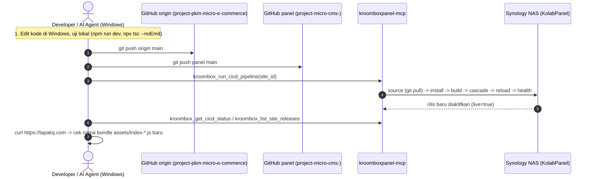

# AGENTS.md — LapakQ (Windows Dev, LapakQ Platform & Panel Guide)

> **PANDUAN OPERASIONAL & ATURAN PENGEMBANGAN AI AGENT**  
> Berkas ini adalah **single source of truth** bagi AI Agent (Cursor, Claude Code, Cline, Antigravity CLI `agy`, dll.) yang mendampingi developer yang bekerja di lingkungan **Windows**, mengelola platform **LapakQ** (`lapakq.com`), dan berinteraksi dengan server Synology NAS melalui **`kroomboxpanel-mcp`**.  
>  
> ⚠️ **CATATAN MIGRASI RESMI:** Seluruh pembaruan dan rilis telah dialihkan sepenuhnya ke **LapakQ** (`lapakq.com`). Jangan lagi mengarahkan rilis publik ke domain Kroomify lama. Repositori kode utama adalah `origin` (`project-pkm-micro-e-commerce`).
>
> 🚚 **REPO DEPLOY ≠ ORIGIN:** NAS menarik kode dari repo GitHub **`project-micro-cms-`** (remote lokal bernama **`panel`**), bukan dari `origin`. Commit baru hanya sampai ke NAS setelah `git push panel main`. Lihat [Bagian 4](#4-panduan-deploy-langkah-demi-langkah-via-mcp-terverifikasi-2026-11-06).

---

## ⚠️ KASUS NYATA & INVARIAN PENTING: MENGAPA TOMBOL PUBLISH SEMPAT TIDAK BERFUNGSI

> [!CAUTION]
> **MASALAH SEBELUMNYA:**
> Saat fitur *"Publish Toko"* dibuat oleh AI agent di Windows, tombol Publish di antarmuka (`PublishStoreModal.tsx`) **hanya meng-update database Supabase** (`stores.is_published = true`) secara client-side, dan sama sekali **TIDAK TERHUBUNG** ke backend API.  
> Akibatnya:
> 1. Webroot fisik di NAS (`/volume1/web/www/KroomBox/kroomify/sites/<slug>`) **tidak pernah dibuat**.
> 2. Virtual host Nginx di `/etc/nginx/sites-enabled/` **tidak pernah di-generate**.
> 3. Cloudflare Tunnel Ingress **tidak terdaftar**.
> 4. Saat pengunjung membuka `https://<slug>.kroombox.com`, Nginx menampilkan halaman default *"Kroombox - Success"*.

### 🔒 INVARIAN MUTLAK:
1. **Kroomify BUKAN Serverless / Frontend-Only SPA**: Kroomify memiliki backend daemon Express aktif di server NAS (PM2 `micro_cms_kromify-api`, port runtime `5058` menurut panel).
2. **Setiap Aksi Fisik Wajib Memanggil Backend API**:
   - Aksi **Publish Toko** Wajib memanggil `POST /api/deploy/publish`.
   - Aksi **Unpublish Toko** Wajib memanggil `POST /api/deploy/unpublish`.
   - Aksi **Midtrans Payment** Wajib memanggil `POST /api/midtrans/snap-token`.
   - Aksi **Biteship Ongkir** Wajib memanggil `POST /api/shipping/rates`.
   - Aksi **Notifikasi Email** Wajib memanggil `POST /api/send-email`.
   DILARANG KERAS hanya melakukan simulasi state di Supabase tanpa mengeksekusi endpoint backend terkait!
3. **JANGAN AUTO-DEPLOY KE LIVE SERVER (CUKUP COMMIT DULU)**:
   - AI Agent **DILARANG KERAS** melakukan auto-deploy ke server NAS (seperti otomatis mengeksekusi `kroombox_run_cicd_pipeline`, restart PM2 live, atau modifikasi file di NAS) tanpa persetujuan / instruksi eksplisit dari developer.
   - Batas pekerjaan otomatis default:
     1. Edit dan uji lokal di Windows (`npm run dev`, `npx tsc --noEmit`).
     2. Lakukan **Git commit** (dan push ke GitHub jika diminta).
     3. Laporkan perubahan kepada developer dan tunggu perintah untuk deploy ke server produksi NAS.

---

## 1. Topologi Lingkungan & Identitas KolabPanel

| Entitas | Detail / Nilai | Catatan Operasional |
|---|---|---|
| **Workstation Developer** | **Windows OS** (PC Lokal) | Tempat developer mengedit kode sumber, menjalankan Git, atau `npm run dev` |
| **Server Host Target** | **Synology NAS DS923+** (Linux DSM 7.2) | IP ZeroTier: `100.90.80.70` \| IP LAN: `192.168.137.1` |
| **Orchestrator Panel** | **KolabPanel v1** (Kroombox Panel) | Panel SaaS multi-tenant yang mengelola hosting dan daemon |
| **KolabPanel Site ID** | **`s_1789953949220_1ee44e`** | **Wajib dipakai pada seluruh parameter `site_id` tool MCP** |
| **User Pemilik Situs** | `akun@kroombox.com` (`u_1789869733181`) | Akun tenant di KolabPanel |
| **Direktori Proyek di NAS** | `/volume1/web/www/KOLABPANEL_USERS/akun@kroombox.com/Micro_CMS_Kromify` | Root working directory aplikasi |
| **Domain Utama CMS** | `https://lapakq.com` | Dashboard admin & merchant login (Produksi) |
| **Subdomain Toko Merchant** | `https://<slug>.lapakq.com` | Storefront publik langsung tanpa login CMS |
| **Repo GitHub yang Ditarik NAS** | `https://github.com/ameliawaruwu/project-micro-cms-.git` (branch `main`) | Remote lokal `panel`. **Wajib** `git push panel main` sebelum deploy |
| **Webroot lapakq.com** | Snapshot **rilis** panel (bukan langsung `dist/`) | Situs live hanya berganti saat rilis baru dibuat oleh pipeline CI/CD (`kroombox_run_cicd_pipeline`) |
| **Backend Express Daemon** | PM2 Process: `micro_cms_kromify-api` (runtime port `5058` menurut `kroombox_get_site_details`) | Runtime Node.js untuk API dan deploy controller. Nama lama `kroomify-api`/`5055` sudah tidak berlaku |
| **Gateway Reverse Proxy** | Nginx DSM (Port `8080`) | Meneruskan traffic publik ke webroot rilis atau port backend |
| **Cloudflare Anycast Tunnel**| Tunnel ID: `19956650-74b4-4479-9c22-79da749256da` | Ingress edge routing publik ke `http://localhost:8080` |

---

## 2. Katalog Backend API Kroomify (Wajib Di-wire oleh Frontend)

Seluruh request API dari frontend dikirim ke path relatif `/api/...`. Nginx port 8080 mem-proxy `/api/` ke backend Express (port runtime saat ini `5058` menurut panel; konfigurasi lama menyebut `5055` — cek `kroombox_get_site_details` sebelum mengandalkan angkanya).

### 2.1 Publikasi Toko (`backend/deployController.ts` → `backend/panelDomainClient.ts`)

Aplikasi ini **tidak** menyentuh nginx, sudo, atau Cloudflare. Publikasi toko = mendaftarkan host toko sebagai alias situs ini lewat **API Kroombox Panel** (`POST/DELETE /api/sites/<KROOMBOX_SITE_ID>/custom-domains`) dengan API key ber-scope `domains:write` + `domains:read`. Panel yang mengatur vhost, ingress tunnel, dan DNS. SPA merender toko dari hostname (`src/utils/domainRouting.ts`), jadi tidak ada file yang dikemas.

* Env: `KROOMBOX_PANEL_API_URL` (default `https://panel.kroombox.com/api`), `KROOMBOX_SITE_ID`, `KROOMBOX_PANEL_API_KEY`.
* Domain induk default `lapakq.com` (BYOD aktif akun ini; kuota 200 subdomain per situs). Domain komunitas lain hanya bisa dipakai bila zonanya milik akun ini; bila tidak, panel menolak dan pesan ditampilkan ke merchant.
* Tidak ada sesi server: setiap request dicek ke tabel `stores` (toko harus ada; slug tidak boleh milik toko lain; host hanya dilepas setelah toko berstatus draf / domain tidak lagi dipakai).

#### A. Publish Toko (`POST /api/deploy/publish`)
* **Dipanggil oleh**: `PublishStoreModal.tsx`.
* **Payload**: `{ "storeId": "...", "slug": "flowerss", "baseDomain": "lapakq.com", "customDomain": "opsional.com" }`
* **Response**: `{ success, message, slug, primaryUrl, customDomainUrl, domains, stages }`. Domain kustom yang ditolak panel muncul sebagai stage `failed`, toko tetap live di subdomain.

#### B. Unpublish Toko (`POST /api/deploy/unpublish`)
* **Dipanggil oleh**: `LayoutPage.tsx` **setelah** toko disimpan sebagai draf.
* **Payload**: `{ "storeId": "...", "baseDomain": "lapakq.com" }`. Menolak (409) bila toko masih terbit.

#### C. Domain kustom (`src/services/domainService.ts`)
* `POST /api/deploy/domains/connect` `{ storeId, hostname }`, `POST /api/deploy/domains/disconnect` `{ storeId, hostname }` (dipanggil setelah `custom_domain` toko dikosongkan), `GET /api/deploy/domains/status?hostname=`.
* `GET /api/deploy/status/:slug?baseDomain=` — status DNS host toko.

---

## 2.2 Endpoint Transaksi, Logistik & Notifikasi (`server.ts`)

| Endpoint | Method | Keterangan & Perlindungan Keamanan |
|---|---|---|
| `/api/midtrans/snap-token` | `POST` | Nominal diambil dari database lewat `resolveBillableAmount()` (bukan `grossAmount` browser), sanitasi order ID/kontak, request Snap token ke Midtrans API menggunakan `MIDTRANS_SERVER_KEY`. |
| `/api/midtrans/notification`| `POST` | Webhook pembayaran dengan validasi signature hash SHA-512 (`order_id + status_code + gross_amount + ServerKey`). |
| `/api/shipping/rates` | `POST` | Proxy ongkir Biteship API. Melindungi `BITESHIP_API_KEY` agar tidak terlihat di browser. |
| `/api/shipping/quote` | `POST` | Tarif ongkir bertanda tangan server (HMAC, 2 jam). Berat dihitung dari tabel `products`; `mode: postal` (Biteship → rumus cadangan) atau `zone` (per kota). `backend/orderController.ts`. |
| `/api/orders/place` | `POST` | Satu-satunya jalur membuat pesanan. Memverifikasi tarif bertanda tangan (toko, berat, tujuan) lalu memanggil `place_order` lewat koneksi DB tepercaya. |
| `/api/send-email` | `POST` | Pengiriman email transaksi/notifikasi via SMTP dengan rate limit (maks 10 email/menit/IP). |
| `/api/media/upload` | `POST` | Upload gambar (produk, logo, QRIS, layout, avatar) ke CDNKroombox (`backend/mediaController.ts`). Wajib sesi login; gambar toko dicek hak kelolanya; tipe dicek dari isi file (JPG/PNG/WEBP/GIF, maks 5MB, SVG ditolak); 30 upload/menit/user. Butuh env server `CDN_API_KEY` (opsional `CDN_API_URL`). Frontend: `src/services/mediaService.ts`. |

---

## 3. Panduan Operasional AI Agent Menggunakan `kroomboxpanel-mcp` dari Windows

Ketika developer bekerja di Windows dan Anda bertindak sebagai AI coding assistant, gunakan tool **`kroomboxpanel-mcp`** untuk berinteraksi dengan server NAS:

### 3.1 Peta Perintah Tool MCP untuk Kroomify

| Tugas Operasional | Nama Tool MCP | Parameter Wajib |
|---|---|---|
| **Cek Info Situs & Port** | `kroombox_get_site_details` | `site_id: "s_1789953949220_1ee44e"` |
| **Cek Log Backend & PM2** | `kroombox_get_site_logs` | `site_id: "s_1789953949220_1ee44e"`, `lines: 50`, `type: "stdout"` |
| **Eksekusi Shell di NAS** | `kroombox_execute_terminal_command`| `site_id: "s_1789953949220_1ee44e"`, `command: "<cmd>"` |
| **Cek Status Git di NAS** | `kroombox_get_git_status` | `site_id: "s_1789953949220_1ee44e"` |
| **Pull Kode Terbaru ke NAS**| `kroombox_git_pull_latest` | `site_id: "s_1789953949220_1ee44e"`, `rebuild: false` |
| **Restart Daemon PM2** | `kroombox_manage_site_process` | `site_id: "s_1789953949220_1ee44e"`, `action: "restart"` |
| **Cek Health & Port** | `kroombox_get_site_health` | `site_id: "s_1789953949220_1ee44e"` |
| **Deploy (build + rilis baru)** | `kroombox_run_cicd_pipeline` | `site_id: "s_1789953949220_1ee44e"` |
| **Pantau Pipeline** | `kroombox_get_cicd_status` | `site_id: "s_1789953949220_1ee44e"` |
| **Daftar Rilis / Rilis Live** | `kroombox_list_site_releases` | `site_id: "s_1789953949220_1ee44e"` |
| **Rollback ke Rilis Lama** | `kroombox_activate_site_release` | `site_id`, `release_id` dari daftar rilis |

### 3.1.1 Batasan `kroombox_execute_terminal_command` (terverifikasi 2026-11-06)
- Menolak karakter shell seperti `|`, `&&`, `( )`, `*` → jalankan **satu perintah per panggilan**.
- Hanya perintah dalam whitelist (contoh: `grep` ditolak; `npm`, `cp`, `ls` diterima).
- Ada **micro-cooldown ±15 detik** antar panggilan; jika muncul pesan `[MCP GUARD]`, tunggu lalu ulangi.
- `npm run lint` (tsc) bisa berhenti dengan `exit_code: 124` (timeout panel) — jalankan `npx tsc --noEmit` di Windows sebagai gantinya.
- Terminal berjalan di folder situs; path di luar itu (mis. `/volume1/web/www/KroomBox`) tidak terlihat.

---

### 3.2 Siklus Alur Kerja Lengkap (Windows Dev -> GitHub -> Panel CI/CD -> Live)

Berikut adalah siklus standar setiap kali ada penambahan/perbaikan fitur (deploy hanya atas instruksi developer, lihat Invarian #3):



---

## 4. Panduan Deploy Langkah-demi-Langkah via MCP (terverifikasi 2026-11-06)

> ⚠️ Jangan memakai alur lama (`npm run build` manual lalu `cp dist/* .../engine/dist` dan `pm2 restart kroomify-api`). Build manual **tidak** mengubah situs live karena lapakq.com disajikan dari snapshot rilis, folder engine tidak bisa diakses dari terminal panel, dan nama proses PM2 sudah berubah.

### Langkah 1: Uji Lokal, Commit & Push ke Kedua Remote
```powershell
npx tsc --noEmit
git push origin main
git push panel main   # repo yang ditarik NAS
```
Pastikan kedua remote menunjuk commit yang sama:
```powershell
git ls-remote origin refs/heads/main
git ls-remote panel refs/heads/main
```

### Langkah 2: (Opsional) Cek Status Git di NAS
`kroombox_get_git_status` dengan `{"site_id": "s_1789953949220_1ee44e"}`. Di NAS ada perubahan lokal yang memang dibiarkan (`ecosystem.config.cjs`, `index.html`, `package-lock.json`); pipeline memakai `auto_stash`, jadi tidak perlu dibersihkan.

### Langkah 3: Migrasi Database (jika ada)
Jika commit membawa file baru di `supabase/migrations/`, terapkan ke Supabase **sebelum** deploy frontend (via MCP Supabase `apply_migration`, atas persetujuan developer), agar fitur baru tidak gagal karena kolom belum ada.

### Langkah 4: Jalankan Pipeline CI/CD Panel
`kroombox_run_cicd_pipeline` dengan `{"site_id": "s_1789953949220_1ee44e"}`. Pipeline berjalan di background (install ±3–5 menit, build ±5 menit) dan membuat rilis baru.

### Langkah 5: Pantau Sampai Selesai
Panggil `kroombox_get_cicd_status` berkala sampai tahap `health` = `success` (tahap `cascade`/`reload` boleh `skipped`). Lalu `kroombox_list_site_releases` untuk memastikan rilis baru `live: true` dengan `commit` yang benar.

### Langkah 6: Smoke Test dari Windows
```powershell
curl.exe -s -o NUL -w "%{http_code}" https://lapakq.com/
curl.exe -s https://lapakq.com/ | Select-String -Pattern "assets/index-[A-Za-z0-9_-]+\.js" -AllMatches
```
Nama bundle `assets/index-*.js` harus berbeda dari rilis sebelumnya, dan header `last-modified` harus setelah waktu pipeline.

### Langkah 7: Restart Backend (hanya jika `server.ts` / `backend/` berubah)
`kroombox_manage_site_process` dengan `{"site_id": "s_1789953949220_1ee44e", "action": "restart"}` (proses PM2 `micro_cms_kromify-api`). Perubahan frontend saja tidak memerlukan restart.

### Rollback
`kroombox_list_site_releases` → pilih rilis sebelumnya → `kroombox_activate_site_release`.

### Catatan Sesi Claude Code
Server `kroomboxpanel-mcp` terpasang di scope lokal (`C:\Users\HP\.claude.json`, token tidak di-commit). Tool-nya baru muncul setelah sesi Claude Code dibuka ulang.

---

## 5. Pengembangan Lokal di Windows (Local Vite Dev Gotchas)

Saat developer menjalankan `npm run dev` di Windows (`http://localhost:3000`):

1. **Proxy API ke NAS**:  
   Agar pemanggilan `/api/...` tidak error atau CORS saat diuji di Windows, pastikan `vite.config.ts` mem-proxy `/api` ke IP NAS:
   ```typescript
   // vite.config.ts
   server: {
     port: 3000,
     proxy: {
       '/api': {
         target: 'http://100.90.80.70:8080', // IP ZeroTier NAS port Gateway
         changeOrigin: true,
         secure: false,
       },
     },
   },
   ```

2. **Windows Line Endings (CRLF vs LF)**:  
   Jangan biarkan Git di Windows mengubah line ending menjadi `CRLF` pada file bash/shell script di folder backend.
   Jalankan di Windows developer jika belum:
   ```powershell
   git config core.autocrlf input
   ```

3. **Format URL Storefront**:  
   Ketika men-generate URL toko di komponen UI (`DashboardPage.tsx`, `SettingsPage.tsx`, `PublishStoreModal.tsx`):
   ```typescript
   // SALAH (Mengarah ke origin CMS):
   const storeUrl = `${window.location.origin}/?toko=${store.slug}`;

   // BENAR (Mengarah ke subdomain independen):
   const storeUrl = store.customDomain 
     ? `https://${store.customDomain}` 
     : `https://${store.slug}.kroombox.com`;
   ```

4. **Event Navigation di Modal**:  
   Pada tombol tautan eksternal (seperti tombol "Kunjungi Toko" di modal), jangan menaruh `e.preventDefault()`, dan pastikan menggunakan `target="_blank"` serta `rel="noopener noreferrer"`.

---

## 6. Aturan Keamanan Kode (WAJIB untuk setiap perubahan)

> [!IMPORTANT]
> Setiap kode baru atau perubahan **wajib** ditulis dengan memperhatikan keamanannya. Anggap semua data dari browser bisa diubah pengguna (DevTools, Postman, skrip), termasuk harga, ongkir, nominal, ID toko, dan status. Periksa poin-poin di bawah sebelum commit.

### 6.1 Uang & status hanya ditentukan server/database
- **Harga produk, ongkir, total, nominal pembayaran, saldo, status lunas, dan paket langganan TIDAK BOLEH berasal dari browser.** Browser hanya mengirim *ID* dan *jumlah*; nilai uang dihitung ulang di server/database.
- Pesanan dibuat lewat `POST /api/orders/place` (→ `place_order`). Ongkir hanya dari tarif bertanda tangan server (`POST /api/shipping/quote`, HMAC, berlaku 2 jam) yang dicek terhadap toko, isi keranjang, dan tujuan. Jangan memanggil RPC `place_order` dari browser.
- Endpoint payment gateway (`/api/midtrans/snap-token`, `/api/duitku/create-invoice`) mengambil nominal dari database lewat `resolveBillableAmount()` (`backend/orderController.ts`). Fitur tagihan baru wajib menambah sumber nominalnya di sana, bukan menerima `grossAmount` dari browser.
- Status lunas hanya diubah server setelah gateway mengonfirmasi, dan nominalnya dicocokkan dengan database (`mark_order_paid`, `mark_domain_paid`).
- Jangan menambah Edge Function/endpoint yang memercayai nominal dari browser.

### 6.2 Query database
- Jangan menyusun SQL dengan menyambung string; di backend pakai parameter `$1, $2` (`pool.query(sql, [nilai])`).
- Filter Supabase `.or()` menerima string mentah. Nilai dari input pengguna wajib dibungkus `pgrstValue()` / `pgrstLikeValue()` (`src/utils/postgrestFilter.ts`). Untuk satu kolom, pakai `.eq()` / `.ilike()` biasa.
- Kolom sensitif (saldo, plan, total pesanan, status) dilindungi trigger/RLS. Tabel atau kolom baru yang menyangkut uang/hak akses wajib diberi RLS dan, bila perlu, trigger penjaga, lewat file migrasi di `supabase/migrations/`.
- Fungsi `SECURITY DEFINER` baru: validasi semua input di dalam fungsi, set `search_path`, dan `GRANT EXECUTE` hanya ke role yang benar-benar butuh.

### 6.3 Validasi input & otorisasi di server
- Validasi tipe, format (regex ID/kode pos), batas panjang, dan rentang angka di server, bukan hanya di form.
- Setiap endpoint yang mengubah data milik toko/pengguna wajib memeriksa sesi dan hak kelola (lihat `backend/sessionAuth.ts`); jangan memercayai `storeId`/`userId` dari body tanpa dicek.
- Pesan error ke pengguna tidak boleh membocorkan detail internal (stack trace, query, kunci).

### 6.4 Rahasia & data pribadi
- API key/secret (Midtrans, Duitku, Biteship, CDN, SMTP, service role) hanya di env server, tidak pernah di `VITE_*` atau kode frontend, dan tidak pernah di-commit.
- Jangan menaruh data pribadi di URL/query string atau log.

### 6.5 Checklist sebelum commit
1. Apakah ada nilai uang/status yang masih datang dari browser? → pindahkan ke server.
2. Apakah ada input pengguna yang masuk ke query/filter tanpa parameter atau escape?
3. Apakah endpoint baru memeriksa sesi & kepemilikan?
4. Apakah tabel/fungsi baru punya RLS/GRANT yang tepat? Migrasi yang mencabut akses lama diterapkan **setelah** kode baru live.
5. `npx tsc --noEmit` lolos. Catatan: `server.ts` & `backend/` tidak termasuk `tsconfig.json`; cek juga dengan
   `npx tsc --noEmit --skipLibCheck --esModuleInterop --module esnext --moduleResolution bundler --target es2022 --lib es2022,dom --types node server.ts backend/<file>.ts`.
